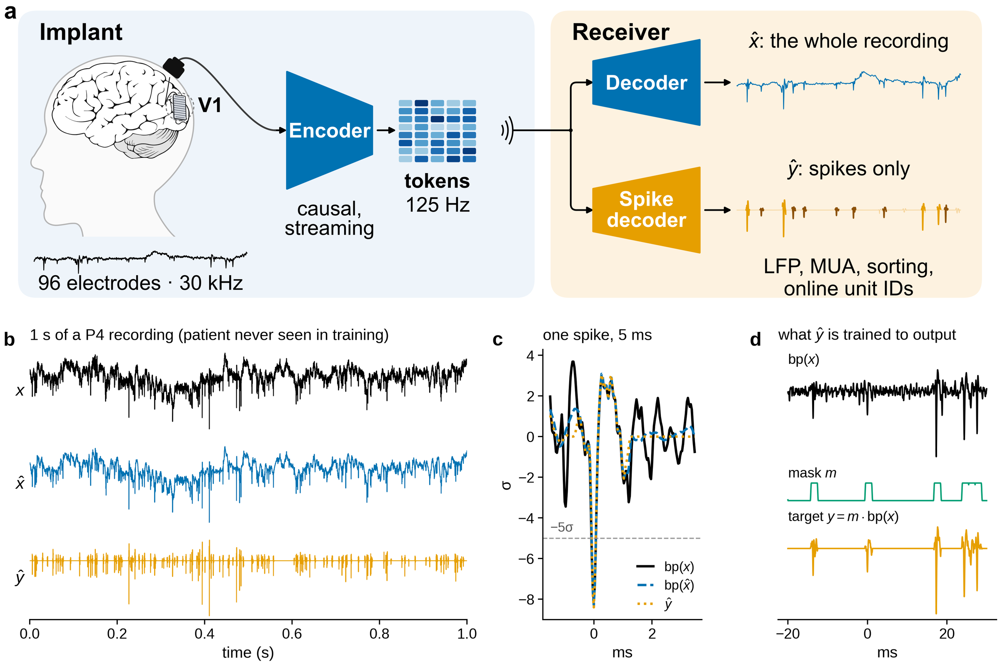

# tokenizer_v2: a causal neural codec for intracortical Utah-array recordings

A streaming encoder turns 30 kHz broadband recordings from a 96-electrode Utah array into
**125 Hz tokens** (32 numbers per electrode every 8 ms). Two decoders read the same tokens:

- **x̂**, the whole recording (LFP, MUA and spikes);
- **ŷ**, the spike band on curated single-unit spikes and silence elsewhere: a denoised spike channel.

Everything downstream (detection, sorting, LFP bands, MUA) runs through fixed readouts. Each is scored
against the original recording, which is the ceiling, and against the curated units of the human-sorted
reference (NIX "Good" units). The encoder is causal: each output waits only for the end of its
own 8 ms frame, and streaming the model frame by frame gives the same output as an offline pass.

This repository holds the code, the evaluation protocol and the results of the bachelor's thesis
(TFG) behind the model. The claim is **temporal compression only** (240 samples → 1 token per
electrode). Nothing here claims a bitrate or a byte count.



## Results (test set, evaluated once)

125 Hz model, mean ± SD over 5 seeds. Every group is scored separately: two later-day groups of
the training patients (P2, P3) and **P4, a patient never seen in training**. *Retention* is the
headline metric: of the curated spikes that a −5σ threshold detector finds on the original
recording, the share it still finds on the model's output. The noise level σ always comes from
the original recording.

| | P2, later days | P3, later days | P4, unseen patient |
|---|---|---|---|
| recordings / curated units | 13 / 161 | 18 / 562 | 20 / 1 086 |
| retention, x̂ | 0.921 ± 0.003 | 0.934 ± 0.003 | 0.957 ± 0.002 |
| retention, ŷ | 0.894 ± 0.003 | 0.909 ± 0.003 | 0.936 ± 0.002 |
| retention, PCA at the same budget | 0.531 | 0.472 | 0.525 |
| detection F1: original / x̂ / ŷ | 0.746 / 0.786 / 0.790 | 0.716 / 0.746 / 0.755 | 0.776 / 0.797 / 0.799 |
| false alarms per min: original / ŷ | 177 / 43 | 110 / 25 | 191 / 96 |
| spike waveform r (x̂) | 0.983 | 0.985 | 0.987 |
| LFP envelope r, lowest band / MUA r | 0.991 / 0.995 | 0.999 / 0.868 | 0.999 / 0.923 |

- Units with spikes at ≥ 12σ have a median retention of 1.0 in every group; the lost spikes are
  mostly the ones that only just cross the threshold on the original.
- At 62.5 Hz, sorting accuracy is unchanged and retention drops by ~0.03. At 31.3 Hz every metric drops.
- Look-ahead (a non-causal model, same architecture) gains 0.01–0.03 retention: that is what
  real-time operation costs.
- Streaming cost per 8 ms frame, all 96 electrodes: 5.6 ms (p50) on one H100, or 4.0 ms with the
  weight norm folded into the weights.

Full numbers, every intermediate decision and the negative results are in
[`experiments/RESULTS.md`](experiments/RESULTS.md), the project's lab notebook. Each number
there comes from a JSON in [`experiments/`](experiments/).

## Repository layout

```
models/            the codec (codec.py) and the baselines at the same budget (baselines.py)
utils/             config, data cache, dataset, signal processing, losses, metrics, sorting, training loop
scripts/           train, evaluate, compare runs, stage plans, figures; preflight/ = pre-flight tests T1–T9
tests/             pytest suite on synthetic recordings in the real cache format (CPU, ~1 min)
app/               the defense demo: two 3D arrays in the browser, curated spikes vs the model's detections
cluster/           SLURM jobs and the Singularity/Docker image used for every run
experiments/       RESULTS.md, every score as JSON, final figures and captions
info/              electrode maps of the three arrays, split summary
```

| design item | code |
|---|---|
| input normalisation (median / MAD of the first 60 s) | `utils/cache.py`, `utils/dataset.py` |
| encoder, tokens, both decoders, causal padding, burn-in, streaming | `models/codec.py` |
| spike mask *m* (from curated spike times), artifact flags | `utils/dsp.py` (`spike_mask`, `artifact_flags`) |
| losses ℒ_time, ℒ_STFT, ℒ_wave, ℒ_spike | `utils/losses.py` |
| spike band bp(·), LFP bands, MUA | `utils/dsp.py` |
| detection, retention, unit recall vs SNR, Victor–Purpura, waveforms, LFP / MUA, probe, streaming | `utils/metrics.py` |
| offline sorting and the online sorter on ŷ | `utils/sorting.py` |
| baselines: PCA (also spike-weighted, also on every training frame), trained linear AE, low-rate sampling, wavelet top-K | `models/baselines.py` |
| split by recording day, held-out patient | `utils/split.py` |
| training, EMA, true resume, W&B monitoring | `utils/train.py`, `utils/plots.py` |
| scoring one group | `scripts/evaluate.py` |

## Model

One electrode is one sequence: the same weights run on all 96 channels, so the codec does not
depend on electrode position and transfers to a new array.

- **Encoder**: 1×1 input conv → 4 strided blocks (strides 8, 5, 3, 2; widths 32 → 512), each a
  strided conv plus dilated residual units (k = 7, dilations 1/3/9) → 1×1 conv to 32 channels.
  240 samples become one token (125 Hz). Appending a ×2 stage halves the rate (62.5, 31.3 Hz).
- **Decoders**: two mirrored stacks (transposed convs, 1.5× wider). One is trained on the recording
  (x̂), the other on the spike target (ŷ).
- **Causality**: every conv is weight-normed and padded on the left only. The receptive field is
  11 280 samples (376 ms). `Codec.stream` keeps each layer's history, so a stream of 8 ms frames
  reproduces the offline output. Training burns in on 11 520 samples (no gradient) before the
  loss span, so training sees what streaming sees. `CAUSAL=0` builds the non-causal ceiling.
- 12.4 M parameters, ELU activations, bf16 autocast, AdamW, weight EMA 0.999.

**Objective** (`utils/losses.py`), on a 7 680-sample loss span:

```
x̂ ← ℒ_time + λ_STFT·ℒ_STFT + ℒ_wave      ℒ_time = |x̂ − x|,   ℒ_wave = |bp(x̂) − bp(x)| inside m
ŷ ← ℒ_spike                                ℒ_spike = weighted |ŷ − m·bp(x)|, weight 1 inside m, λ_bg outside
```

*m* is a Tukey window over [t − 21, t + 40) samples at each curated spike time. The curated waveforms
themselves are never a target (they are whitened; see T1). No loss masks artifacts: the artifact
flag only clears *m* and splits the metrics. λ_STFT = 0 and λ_bg = 0.1 were chosen by the pre-flight
tests and the S5 search.

## Evaluation rules

These rules protect the numbers. The code enforces them:

- **The held-out patient never touches training**: not a sample, not a statistic, not an operating
  point. `utils/train.py` refuses to start if P4 is in `TRAIN_PATIENTS`.
- **Whole recording days** go to one split; P2 and P3 are cut chronologically (train → validation →
  test). `utils/split.py` asserts it.
- **Groups are never pooled**: `scripts/evaluate.py` takes exactly one group.
- **σ comes from bp(x)**, stored at cache time, never from a reconstruction: a smoother output has a
  lower noise level, so measuring σ on it would inflate recall.
- **Recall is against curated Good units; precision against Good + Bad units**: a detection counts as
  a false alarm only if it matches no reference spike of any label.
- **Test once.** Nothing is re-tuned after the test groups are scored (S10).
- **Noise floor.** A difference smaller than the spread over five seeds (T7) is reported as "no difference".

## Installation

Python 3.12, [uv](https://docs.astral.sh/uv/):

```bash
uv sync                    # add --extra sorting where a C++ compiler is available (isosplit6, offline sorting)
uv run pytest -q           # 61 tests on synthetic recordings, CPU, about a minute
uv run ruff check .
```

The tests build small recordings in the real cache format and test, among other things: causality
and stream = offline, channel independence, every loss term, the detector, matching and
Victor–Purpura distance on planted spike trains, the split rules, an exact resume of a training
run, and the demo app's counters against the evaluation detector.

## Data

The recordings are intracortical Utah-array data from human participants (P2, P3, P4: Blackrock
NS5 files at 30 kHz, with spike sorting in NIX files) and **are not distributed**. For the same
reason `info/splits.csv`, which lists the recordings by name and date, is not in the repository.
`info/splits_summary.csv` gives the number of recordings and days per group, and recording names
in the results are pseudonymised.

With access to data in the same format (one folder per patient with a `table.csv` listing
`signals,spikes` file pairs):

```bash
cp .env.example .env                                 # set DATA_PATH and CACHE_DIR
python -m utils.split                                # info/splits.csv, with its integrity checks
python -m utils.cache --patients P2 P3 P4 --workers 8
python -m utils.cache --report                       # % of time flagged per artifact rule
```

The cache holds one `int16 [96, T]` array per recording, plus its normalisation, its σ of bp(x),
the curated spike *times* of every unit (labelled Good / Bad) and the artifact spans.

## Reproducing the experiments

Every setting lives in `.env` (documented in `.env.example`) and reaches the code through a
dataclass. A `KEY=VALUE` argument overrides it for one run:

```bash
python -m scripts.train --exp-name sanity MAX_STEPS=200 EVAL_INTERVAL=50 VAL_WINDOWS=16
python -m scripts.evaluate runs/<run>/step_200000.pt --group p2_late
python -m scripts.evaluate pca --group p2_late        # also pcaw-<w>, pcafull, lowrate, wavelet, identity
```

Re-running an existing run name resumes it exactly: weights, EMA, optimizer, scheduler and the
position in the data stream. The experiment ran in stages. Each stage was fixed in
`experiments/<stage>_arms.json` before its runs started, and was scored against the T7 noise floor
by `scripts/compare.py`:

| stage | question | entry point → output |
|---|---|---|
| T1 | which signal space the curated waveforms live in, where the spike time sits | `scripts/preflight/t1_nix_space.py` → `experiments/t1.json` |
| T2 | receptive field, burn-in and memory per token rate | `t2_receptive_field.py` |
| T3 | the reference detector's threshold (K = 5) | `t3_threshold.py` |
| T4 | causality and time per frame | `t4_streaming.py` |
| T5 | linear floors: PCA and low-rate sampling at the same budget | `t5_linear_floors.py` |
| T6 | which loss weighting keeps x̂ from collapsing, per rate | `t6_collapse.py` |
| T7 | noise floor: 5 seeds of one configuration | `t7_noise_floor.py` |
| T8 | the online sorter's parameters | `t8_online_sorting.py` |
| T9 | recipe sanity checks: loss at init, zero input, overfit two batches | `t9_sanity.py` |
| S5 | learning rate × weight decay × scheduler × λ_bg random search, 15 k steps | `scripts/stage.py s5` → `s5.json` |
| S6 | token rate: 62.5 / 31.3 / 15.6 Hz | `stage.py s6` → `s6.json` |
| S7 | one-factor ablations: no ℒ_spike, ℒ_STFT, no ℒ_wave, *m* from unlabeled crossings, mask edges | `stage.py s7` → `s7.json` |
| S8–S9 | 5 seeds × 200 k steps per finalist, scored on validation | `stage.py s8` → `s9.json` |
| S10 | the test groups, once | `scripts/compare.py --stage s10` → `s10.json` |
| S11 | figure data (needs the cached recordings) and figures | `scripts/figure_data.py`, `scripts/figures.py` |
| S12 | a fresh spike decoder on the frozen encoder; the demo app | `stage.py s12` → `s12.json`; `app/` |

On a SLURM cluster, `cluster/stage.sh` submits a whole stage and its scorer. See
[`cluster/README.md`](cluster/README.md).

## Demo app

`app/` is the defense demo: two 3D Utah arrays in the browser, the curated spikes on the left and
the detections on the model's ŷ on the right, with live counters computed by the same `detect()`
as the evaluation (checked in `tests/test_app.py`). three.js and the fonts are vendored, so it
runs offline.

```bash
python -m app.precompute <recording> --electrodes 96    # ŷ and the tokens of the whole array
python -m app.export <recording>                        # the bundle the page plays
python -m app                                           # http://localhost:8000
```

## License

MIT, see [LICENSE](LICENSE). The vendored three.js (`app/web/vendor/three`) keeps its own MIT license.
